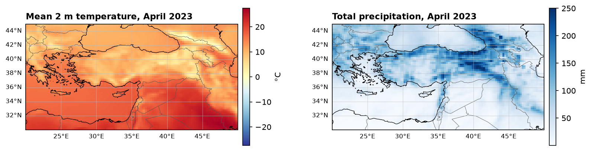
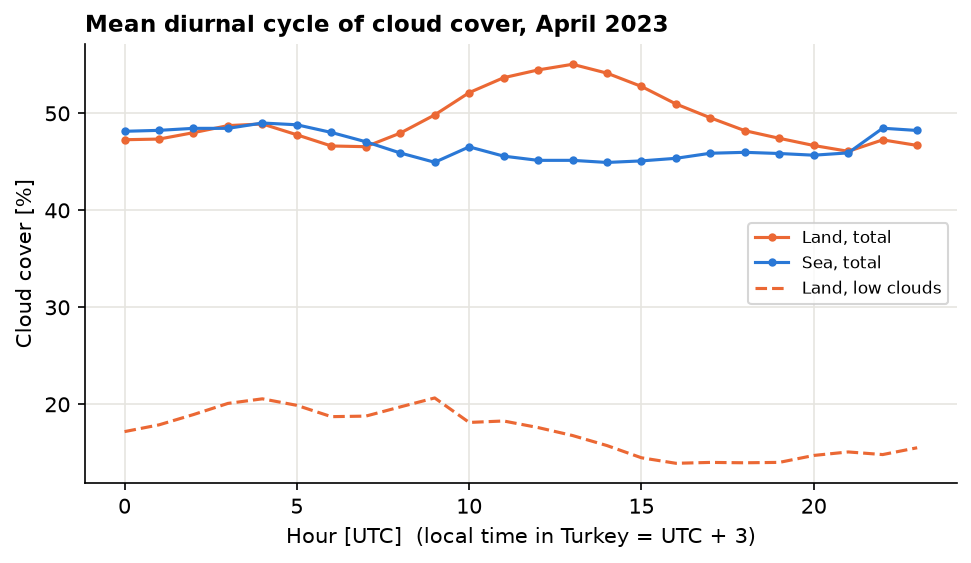
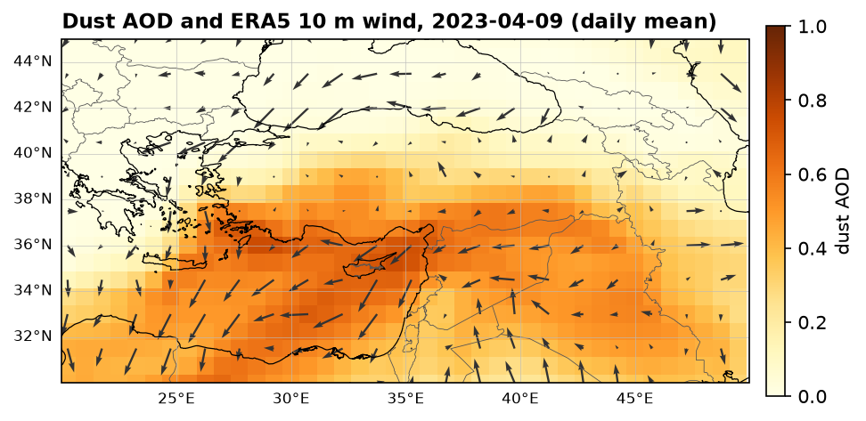
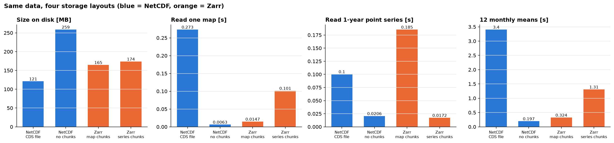

# Multidimensional Earth Observation Data Processing

**Python · Xarray · NetCDF · Zarr · Jupyter**

A set of Jupyter notebooks that read, organise and visualise gridded atmospheric
datasets (**ERA5** reanalysis and **CAMS** atmospheric composition reanalysis) with
Python and Xarray, and compare the classic **NetCDF** format with the cloud-native
**Zarr** format.

Case study: **Turkey and the Eastern Mediterranean (30–45°N, 20–50°E), April 2023**,
a spring month with frontal rain and a strong desert dust outbreak.

| Notebook | What it does |
|---|---|
| [`01_era5_first_look`](notebooks/01_era5_first_look.ipynb) | Structure of an xarray Dataset, selection, unit conversion, maps, city time series, diurnal cycle |
| [`02_cloud_properties`](notebooks/02_cloud_properties.ipynb) | Low/medium/high cloud cover, liquid and ice water path, land–sea diurnal cycle, cloud water vs. rain |
| [`03_cams_air_quality`](notebooks/03_cams_air_quality.ipynb) | Aerosol optical depth, a dust event, PM10/PM2.5 at cities, combining CAMS with ERA5 wind |
| [`04_netcdf_vs_zarr`](notebooks/04_netcdf_vs_zarr.ipynb) | File structure, chunking, loading-speed benchmark, reading ERA5 directly from a public cloud Zarr store |

---

## Main results

### ERA5: temperature, precipitation and the diurnal cycle



- The monthly temperature map mainly follows the topography: the Anatolian plateau
  and the eastern highlands are much colder than the coasts.
- The most precipitation fell over the mountains of eastern and south-eastern
  Anatolia, the Zagros and the Caucasus (orographic lifting). The wettest day over
  the region was **12 April 2023**.
- Continentality: the mean daily temperature range was **3.5 °C** at the Istanbul
  grid point and **9.1 °C** at Ankara.

### Clouds



- High clouds were the most common type (34 % mean cover; medium 23 %, low 16 %).
  Low clouds follow the mountain ranges.
- Over land, total cloud cover peaks at **13 UTC (16:00 local time)** because of daytime
  convection; over the sea the diurnal cycle is weak.
- The probability of rain grows strongly with cloud water + ice path: below
  0.02 kg m⁻² it almost never rains, above 0.5 kg m⁻² it rains in about 90 % of the hours.

### CAMS: a desert dust outbreak



- A strong dust event on **7–11 April 2023** covered the Eastern Mediterranean and
  southern, central and eastern Turkey (region-mean dust AOD peaked on 9 April).
- Daily PM10 at the CAMS grid points of Erzurum, Ankara and Antalya reached
  about 1.4–2.8 times the WHO 24-hour guideline (45 µg m⁻³). Istanbul and Izmir were almost
  not affected.
- Over Anatolia, PM10 and dust AOD were strongly correlated (r > 0.8) during the month.

### NetCDF vs. Zarr



One year of hourly ERA5 2 m temperature (8760 × 61 × 121) was stored in four ways
and read back (median of 5 runs, local SSD, warm cache):

| Layout | Size | One map | 1-year point series | 12 monthly means |
|---|---|---|---|---|
| NetCDF as delivered by CDS (zlib, chunks 2920×21×41) | 121 MB | 0.27 s | 0.10 s | 3.4 s |
| NetCDF, no chunks, no compression | 259 MB | 0.006 s | 0.021 s | 0.20 s |
| Zarr, chunked for maps (24×61×121) | 165 MB | 0.015 s | 0.185 s | 0.32 s |
| Zarr, chunked for time series (8760×10×10) | 174 MB | 0.101 s | 0.017 s | 1.3 s |

- **The chunk shape decides what is fast**, more than the format name: each Zarr
  layout is about 7–11× faster for the task it was chunked for.
- On a local disk the uncompressed NetCDF is fastest (no decompression), but it is
  twice as large. Over a network, small compressed chunks matter much more.
- The full ERA5 archive on Google Cloud (**ARCO-ERA5**, 3.7 PB) opened in ~6 s as a
  Zarr store. Reading one global map took ~2.5 s, but a 48-hour series at one point
  took ~17 s, because the store is chunked as one hour per chunk. Its values agree
  with our CDS download within 0.001 K.

The exact timings will be different on another computer; the relative differences
are what matters.

---

## How to run

Requirements: Linux, [Miniconda](https://docs.conda.io/en/latest/miniconda.html) and a
free Copernicus account.

**1. Environment**

```bash
conda env create -f environment.yml
conda activate eo-data
```

**2. Copernicus API key**

1. Register at the [Atmosphere Data Store](https://ads.atmosphere.copernicus.eu); the
   same account works on the [Climate Data Store](https://cds.climate.copernicus.eu).
2. Accept the licence on the *Download* tab of both datasets:
   [ERA5 hourly single levels](https://cds.climate.copernicus.eu/datasets/reanalysis-era5-single-levels) and
   [CAMS global reanalysis (EAC4)](https://ads.atmosphere.copernicus.eu/datasets/cams-global-reanalysis-eac4).
3. Copy your API token from your profile page and save it (never commit this file):

```bash
printf 'url: https://cds.climate.copernicus.eu/api\nkey: <TOKEN>\n'   > ~/.cdsapirc
printf 'url: https://ads.atmosphere.copernicus.eu/api\nkey: <TOKEN>\n' > ~/.adsapirc
```

**3. Run everything**

```bash
bash scripts/run_all.sh
```

This downloads ~235 MB of data into `data/` (not stored in the repository),
converts it, runs the benchmark and executes the four notebooks. Download time
depends mostly on the Copernicus queue (5–30 min). To explore interactively, run
`jupyter lab` and open the `notebooks/` folder.

## Repository structure

```
├── environment.yml          conda environment
├── scripts/
│   ├── config.py            region, period, variables, paths
│   ├── download.py          ERA5 (CDS) and CAMS (ADS) downloads with cdsapi
│   ├── convert_formats.py   NetCDF -> NetCDF (no chunks) and two Zarr layouts
│   ├── benchmark.py         loading-speed benchmark -> results/benchmark.csv
│   ├── helpers.py           opening files, map plotting, unit conversion
│   └── run_all.sh           full pipeline
├── notebooks/               4 notebooks (.ipynb with outputs + .py text version)
├── figures/                 figures saved by the notebooks
├── results/benchmark.csv
└── data/                    downloaded and converted data (git-ignored)
```

The notebooks are also kept as plain `.py` files ([Jupytext](https://jupytext.readthedocs.io)
"percent" format), so changes are easy to read in git.

## Sources: what comes from where

| Part | Source |
|---|---|
| ERA5 hourly single-level data | Copernicus Climate Change Service, Climate Data Store [1]; ERA5 description [2] |
| CAMS EAC4 aerosol and air-quality data | Copernicus Atmosphere Monitoring Service, Atmosphere Data Store [3]; EAC4 description [4] |
| Cloud-native ERA5 Zarr store (notebook 04) | ARCO-ERA5, Google Research [5] |
| Download API and settings (`url`, `key`, request format) | `cdsapi` client and the CDS/ADS "How to API" pages [6] |
| Definitions of low/medium/high cloud cover and cloud water paths | ECMWF IFS documentation, Part IV: Physical processes [7], ERA5 parameter descriptions [2] |
| Relative humidity from dew point (Magnus formula, a = 17.625, b = 243.04 °C) | Alduchov & Eskridge (1996) [8] |
| WHO air-quality guideline values (PM10 45 µg m⁻³, PM2.5 15 µg m⁻³, 24-h mean) | WHO (2021) [9] |
| NetCDF format | Rew & Davis (1990) [10], Unidata NetCDF documentation |
| Zarr format | Zarr specification v3 [11] |
| Xarray | Hoyer & Hamman (2017) [12] |
| Study region, period, analysis choices, benchmark design | My own choices |
| Interpretation of the results | My own, based on the figures in the notebooks |

### Data licence and attribution

Contains modified Copernicus Climate Change Service information (2023) and
Copernicus Atmosphere Monitoring Service information (2023). Neither the European
Commission nor ECMWF is responsible for any use that may be made of the Copernicus
information or data it contains.

## References

1. Hersbach, H. et al. (2023). ERA5 hourly data on single levels from 1940 to present. Copernicus Climate Change Service (C3S) Climate Data Store (CDS). https://doi.org/10.24381/cds.adbb2d47
2. Hersbach, H. et al. (2020). The ERA5 global reanalysis. *Quarterly Journal of the Royal Meteorological Society*, 146, 1999–2049. https://doi.org/10.1002/qj.3803
3. CAMS global reanalysis (EAC4). Copernicus Atmosphere Monitoring Service (CAMS) Atmosphere Data Store (ADS). https://ads.atmosphere.copernicus.eu/datasets/cams-global-reanalysis-eac4
4. Inness, A. et al. (2019). The CAMS reanalysis of atmospheric composition. *Atmospheric Chemistry and Physics*, 19, 3515–3556. https://doi.org/10.5194/acp-19-3515-2019
5. Carver, R. W. and Merose, A. (2023). ARCO-ERA5: An Analysis-Ready Cloud-Optimized Reanalysis Dataset. 22nd Conf. on AI for Environmental Science, AMS Annual Meeting, Denver, 4A.1. https://github.com/google-research/arco-era5
6. ECMWF. CDS / ADS API setup. https://cds.climate.copernicus.eu/how-to-api, https://ads.atmosphere.copernicus.eu/how-to-api
7. ECMWF (2016). IFS Documentation CY41R2 – Part IV: Physical Processes. https://doi.org/10.21957/tr5rv27xu
8. Alduchov, O. A. and Eskridge, R. E. (1996). Improved Magnus form approximation of saturation vapor pressure. *Journal of Applied Meteorology*, 35, 601–609.
9. World Health Organization (2021). *WHO global air quality guidelines: particulate matter (PM2.5 and PM10), ozone, nitrogen dioxide, sulfur dioxide and carbon monoxide.* Geneva: WHO.
10. Rew, R. and Davis, G. (1990). NetCDF: an interface for scientific data access. *IEEE Computer Graphics and Applications*, 10(4), 76–82.
11. Zarr Developers. Zarr storage specification version 3. https://zarr-specs.readthedocs.io/en/latest/v3/core/index.html
12. Hoyer, S. and Hamman, J. (2017). xarray: N-D labeled arrays and datasets in Python. *Journal of Open Research Software*, 5(1), 10. https://doi.org/10.5334/jors.148

## Limitations

- One month and one region only; the results describe April 2023, not a climatology.
- City values are grid-box values (ERA5 ~28 km, CAMS ~80 km), not station observations.
- The benchmark was run on one laptop with a warm file cache; cloud timings depend on the
  internet connection.
- Dust transport was not traced with pressure-level winds or trajectories.
